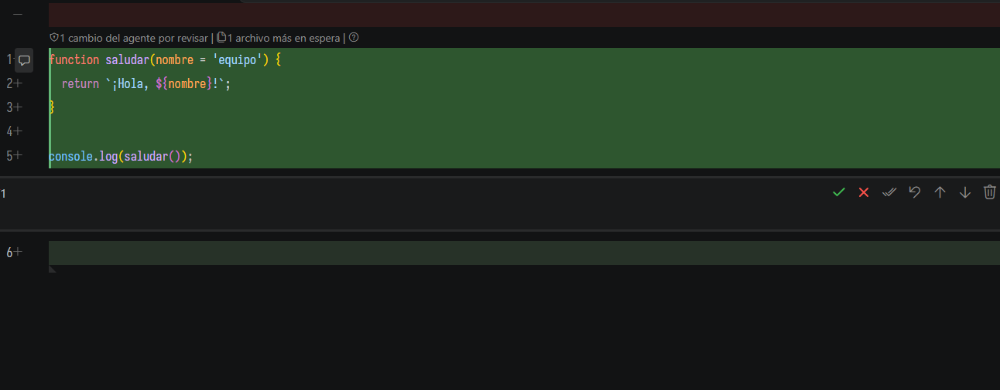

# Agent Review

Extensión para VS Code y forks compatibles (Antigravity, Cursor, Windsurf) que
te deja revisar bloque por bloque los cambios de un agente de IA, al estilo de
Copilot: cada bloque se acepta o se rechaza dentro del editor.

Autor: AndreeBermudez.

## Así funciona



## Fuentes de cambios

| Fuente | Cómo llega | Disco |
| --- | --- | --- |
| **Codex** (`apply_patch`) | Hook `PreToolUse` que registra el archivo antes del parche | El cambio ya está aplicado; rechazar lo revierte |
| **Claude Code** (`Edit`, `Write`, `MultiEdit`) | Hook `PreToolUse` que guarda una copia del archivo antes de editar | El cambio ya está aplicado; rechazar lo revierte |

La extensión revisa cambios de Codex hechos con `apply_patch`. Los cambios que
Codex ejecuta mediante comandos de terminal no se capturan automáticamente.

## Activar y desactivar

El escudo de la barra inferior abre un menú con los archivos pendientes, el
interruptor y la ayuda. También está el comando *Agent Review: Activar/desactivar
revisión*:

- **Activo**: la extensión deja un latido en `~/.agent-review/active` cada 1,5 s
  y el hook registra cada edición. Cada cambio pasa por tu revisión.
- **Desactivado**: se borra el latido y el hook no registra nada. Los cambios se
  aplican directo, sin preguntar.

Si cierras VS Code, el latido vence a los 30 s y el hook deja de registrar solo.

## Cómo se revisa

1. El agente cambia un archivo; se abre el editor de diferencias en línea: lo
   eliminado en rojo, lo nuevo en verde.
2. En la primera línea: cuántos cambios quedan y `?` para la ayuda.
3. Debajo de cada bloque, un recuadro compacto con `i/N` y botones de ícono:
   ✓ (verde) y ✗ (rojo) para el bloque, ✓✓ y ⟲ para todo el archivo, ↑ ↓ para
   moverse. Un punto azul en el margen y en la barra de desplazamiento marca
   cada bloque pendiente.

El escudo azul de la barra inferior activa o desactiva la revisión con un clic.
Con archivos pendientes muestra el número y abre la lista (desde ahí también se
desactiva).
4. Al resolver el último bloque, por cualquier camino (botones, atajos o la
   reversión de VS Code), se guarda el archivo y se cierra la pestaña. Si el
   archivo era nuevo y lo rechazas entero, se envía a la papelera.
5. Si cierras la pestaña antes, la revisión queda pausada; se retoma desde el escudo.

La primera vez aparece un aviso con la ayuda; después está en el `?` y en el menú.

| Atajo | Acción |
| --- | --- |
| `Ctrl+Alt+Y` | Aceptar el bloque bajo el cursor |
| `Ctrl+Alt+N` | Rechazar el bloque bajo el cursor |
| `Ctrl+Alt+]` / `Ctrl+Alt+[` | Siguiente / anterior bloque |

## Instalar la extensión

En VS Code abre **Extensions** → menú **…** → **Install from VSIX…** y elige
el archivo `.vsix` de la extensión. Si usas perfiles, instálala en el perfil
con el que abres tu proyecto:

```powershell
code --install-extension <archivo.vsix> --profile "<perfil>"
```

Para generar el VSIX desde el código fuente, abre una terminal en la carpeta
que contiene `package.json` y ejecuta:

```powershell
npx @vscode/vsce package
```

Esto crea un archivo `.vsix` que puedes instalar siguiendo los pasos anteriores.

## Conectar Claude Code

En VS Code ejecuta **Agent Review: Conectar con Claude Code** desde `Ctrl+Shift+P`
y confirma. La extensión copia el hook a `~/.agent-review/snapshot.js` y lo
registra en `~/.claude/settings.json`; antes de modificar ese archivo guarda una
copia en `~/.claude/settings.json.agent-review.bak`.

Después, en Claude Code abre `/hooks` una vez o reinicia la sesión para que
cargue el hook. Requiere Node.js instalado y disponible en el `PATH`.

El hook nunca bloquea la herramienta: si algo falla, sale en silencio. Si
prefieres configurarlo a mano, agrega el hook `PreToolUse` para
`Edit|Write|MultiEdit` en `~/.claude/settings.json`.

Con Agent Review activo, el hook responde `permissionDecision: "allow"` para los
archivos dentro de las carpetas del workspace abierto (la extensión las publica
en el latido). Así Claude Code no muestra su propia aprobación y la revisión se
hace solo con Agent Review. Fuera del workspace, o con la revisión desactivada,
el hook no responde nada y Claude Code pide permiso como siempre.

## Conectar Codex

En VS Code ejecuta **Agent Review: Conectar con Codex**. Se agrega un hook
`PreToolUse` para `apply_patch` en `~/.codex/hooks.json`; luego reinicia Codex y
confía el hook desde `/hooks` cuando Codex lo solicite. El hook guarda la copia
anterior de cada archivo y Agent Review muestra la revisión después de aplicar
el parche. Solo captura llamadas `apply_patch` dentro de las carpetas abiertas
en VS Code.

## Configuración

| Clave | Por defecto | Descripción |
| --- | --- | --- |
| `agentReview.enabled` | `true` | Interruptor general. |
| `agentReview.viewMode` | `diff` | `diff`: editor de diferencias. `editor`: editor normal con resaltado. |
| `agentReview.autoOpen` | `true` | Abrir la revisión en cuanto llega un cambio. |
| `agentReview.saveOnResolve` | `true` | Guardar al resolver el último bloque. |
| `agentReview.pollIntervalMs` | `1500` | Intervalo de revisión de las carpetas. |

La extensión activa `diffEditor.codeLens` para que los botones aparezcan en el
editor de diferencias, y apaga `diffEditor.renderGutterMenu` (la flecha ↺ del
margen) para evitar reversiones accidentales; puedes volver a encenderla en tus ajustes. Para la vista en línea usa *Inline View* en el menú `…`
del diff, o `"diffEditor.renderSideBySide": false`.

## Limitaciones

- Con Claude Code el cambio ya está en disco mientras lo revisas; si el agente
  vuelve a editar un archivo con bloques rechazados sin guardar, VS Code avisará
  de conflicto al guardar.
- Varias ediciones seguidas sobre el mismo archivo se agrupan en una sola
  revisión, desde el estado anterior a la primera.
- Solo se revisan archivos dentro de las carpetas del workspace abierto.
- Los saltos de línea se comparan sin distinguir CRLF/LF.
